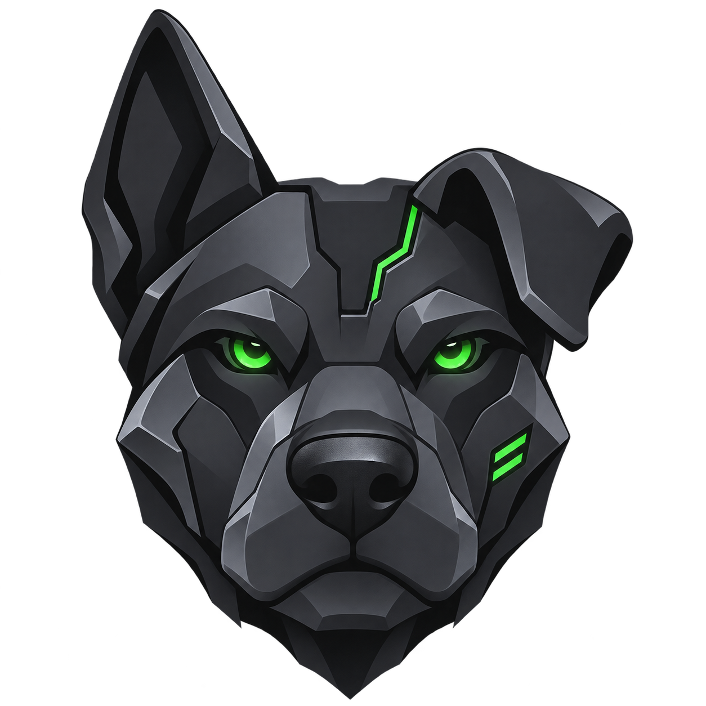

<div align="center">



<h1>Azor</h1>

<p><b>A Claude Code hook that knows what your computer has been doing</b></p>

<p>
<a href="https://archlinux.org"></a>
&nbsp;&nbsp;&nbsp;
<a href="https://cachyos.org"></a>
</p>

</div>

Azor is a hook for Claude Code, backed by a small telemetry daemon. The daemon records load, temperatures, disks, services, configuration and package changes, also while Claude is closed. The hook gives Claude a one-line summary when a session starts, and a skill lets it look up the history when you ask what happened. Hardware is detected automatically. No root; Azor itself makes no network connections, but what the hook prints becomes part of your Claude conversation.

## Installation

Needs Go 1.22 or newer.

```sh
git clone https://github.com/ultherego/azor.git
cd azor/packaging/local
makepkg -si
systemctl --user enable --now azor
```

Or without root, from the project directory:

```sh
make install
```

Then connect it to Claude Code as described in [claude/README.md](claude/README.md).

## Configuration

Optional: everything is detected without it. `azor init` creates `~/.config/azor/azor.conf`, where you can add your own things or switch something off:

```ini
# collect everything except network traffic
modules = all, -network

# follow these programs
watch.processes = firefox, steam

# report when this file changes (it is never opened)
watch.files = ~/scripts/backup.sh

# report when this service starts, stops or fails
watch.units = docker.service

# do not report this timer
ignore.timers = man-db

# warn when the CPU reaches 85 C
alert.cpu_temp = 85
```

Apply it with `systemctl --user restart azor`.

## How it works

1. **Record** – a small background service reads the sensors every 2 seconds and stores the average and the peak every 10 seconds.
2. **Keep** – the data stays on your computer, in `~/.local/state/azor`, for 7 days.
3. **Tell** – when a Claude Code session starts, the hook gives Claude one line with the current state.
4. **Ask** – when you ask what happened, Claude runs `azor` to read the history. You can do the same:

```sh
azor                      # now
azor range 12:00 15:00    # what happened between 12:00 and 15:00
azor events               # alerts and changes
azor desktop              # detected desktop, displays and restarts
azor health               # problems such as a needed reboot
azor timers               # backups, snapshots and other scheduled jobs
```

Keys, passwords, the clipboard, browsers and shell history are off limits, even if you list them in the configuration. The service runs without root and without internet access, and can write only its own data.
